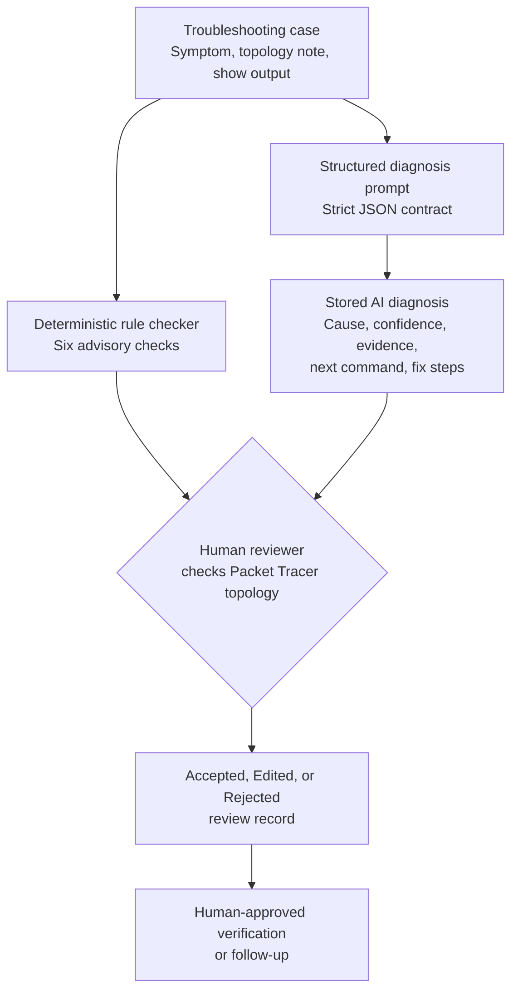
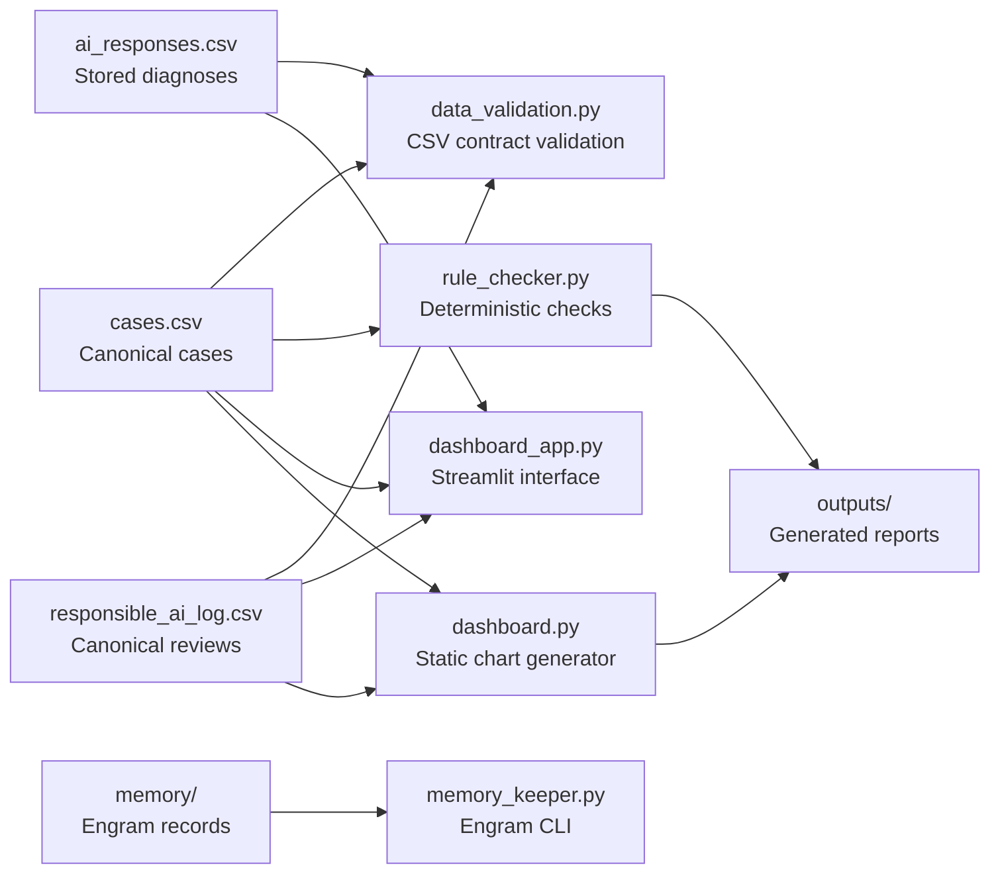

# NetSage AI

> AI-assisted Cisco Packet Tracer troubleshooting with deterministic checks and mandatory human review.

NetSage AI is an educational network-troubleshooting prototype for Cisco Packet Tracer labs. It combines structured fault cases, a strict diagnostic JSON contract, deterministic Python checks, stored AI diagnosis records, and human review. It supports evidence-based troubleshooting without giving an AI system authority to alter a network topology.

**Safety boundary:** the Packet Tracer topology is the source of truth. Every proposed network change must be reviewed by a human and recorded as `Accepted`, `Edited`, or `Rejected` before it is acted upon.

## Contents

- [What the project does](#what-the-project-does)
- [Current project baseline](#current-project-baseline)
- [Architecture](#architecture)
- [Repository structure](#repository-structure)
- [Requirements and installation](#requirements-and-installation)
- [Run the project](#run-the-project)
- [Data contracts](#data-contracts)
- [Human-review workflow](#human-review-workflow)
- [Testing and verification](#testing-and-verification)
- [Diagnostic-runner caution](#diagnostic-runner-caution)
- [Dashboard deployment notes](#dashboard-deployment-notes)
- [Limitations](#limitations)
- [Contributing](#contributing)

## What the project does

NetSage AI helps a learner investigate common Cisco network-lab failures, including VLAN, gateway, DHCP, DNS, routing, ACL, NAT, wireless, switching, STP, security, IP-addressing, and physical-connectivity scenarios.

For each troubleshooting case, the project stores:

- an observed symptom;
- topology context;
- Cisco-style `show` command output;
- a reference fault for the lab scenario;
- a stored structured AI diagnosis; and
- any available human-review decision.

The project has two complementary analysis paths:

1. **Deterministic rule checking** identifies selected, evidence-based configuration patterns.
2. **AI-assisted diagnosis** provides a structured advisory diagnosis from the supplied evidence.

Neither path applies a fix automatically.

## Current project baseline

| Item | Current verified state |
| :-- | :-- |
| Canonical troubleshooting cases | 35 records in `cases.csv` |
| Stored AI diagnoses | 35 records in `ai_responses.csv` |
| Canonical human-review records | 5 records in `responsible_ai_log.csv` |
| Recorded review outcomes | 4 `Edited`, 1 `Rejected` |
| Deterministic checker rules | 6 |
| Interactive interface | Local Streamlit dashboard via `app.py` |
| Static reporting | PNG charts generated under `outputs/reports/` |

## Architecture

### Evidence-to-review troubleshooting flow



The rule checker and diagnosis workflow are advisory inputs. A reviewer verifies the evidence against the Packet Tracer topology and records a decision before any proposed action is considered.

### Code and data component layout



The implementation modules live in `src/netsage/`. Root Python files are small compatibility launchers that preserve the documented commands.

## Repository structure

The following tree shows the maintained project layout. Generated artifacts are written under `outputs/`; caches, credentials, and machine-local tooling are intentionally omitted.

```text
netsage-ai-project/
├── app.py                         # Streamlit compatibility entry point
├── data_validation.py             # CSV-validation compatibility entry point
├── rule_checker.py                # Rule-checker compatibility entry point
├── dashboard.py                   # Static-chart compatibility entry point
├── run_diagnostics.py             # Model-runner compatibility entry point
├── memory_keeper.py               # Engram-CLI compatibility entry point
├── cases.csv                      # Canonical troubleshooting cases
├── ai_responses.csv               # Canonical stored AI diagnoses
├── responsible_ai_log.csv         # Canonical human-review log
├── diagnose_prompt.md             # Strict model JSON contract
├── config/
│   └── config.yaml                # Project configuration placeholder
├── data/
│   ├── README.md                  # Deprecated-copy migration guidance
│   ├── raw/                       # Deprecated migration artifacts
│   └── processed/                 # Deprecated migration artifacts
├── memory/
│   ├── engram_map.json            # Case-memory records
│   └── engram_schema.json         # Engram schema reference
├── outputs/                       # Generated and ignored artifacts
│   ├── reports/                   # Static dashboard PNG files
│   └── rule_checker_output.txt    # Rule-checker report
├── reports/
│   ├── generate_pragati_report.py
│   ├── Pragati_Kumari_Report.md
│   ├── Pragati_Kumari_Report.docx
│   └── Pragati_Kumari_Report_TEMPLATE.md
├── src/
│   └── netsage/
│       ├── __init__.py
│       ├── dashboard_app.py       # Streamlit user interface
│       ├── dashboard_data.py      # Dashboard CSV service and review overlay
│       ├── dashboard.py           # Static chart generator
│       ├── data_validation.py     # Canonical CSV validators
│       ├── diagnostics.py         # Model diagnostic runner
│       ├── memory_keeper.py       # Engram management CLI
│       ├── rule_checker.py        # Six deterministic checks
│       └── utils.py               # Shared helpers
├── tests/
│   ├── fixtures/
│   ├── test_dashboard_data.py
│   ├── test_data_validation.py
│   ├── test_rule_checker.py
│   └── test_utils.py
├── pyproject.toml
├── requirements.txt
└── README.md
```

## Requirements and installation

- Python 3.10 or newer
- Cisco Packet Tracer for topology-based human verification
- Python packages listed in `requirements.txt`

Install the application and test dependencies:

```powershell
python -m pip install -r requirements.txt pytest
```

The package uses a `src/` layout. Root launchers add `src/` to the import path so the commands below work from the repository root without an editable install.

## Run the project

Run all commands from the repository root.

### Validate the canonical CSV contracts

```powershell
python data_validation.py
```

This checks the expected column order, valid enum values, required fields, unique case IDs, and the current 35-record contract for the cases and diagnosis files.

### Run deterministic checks

```powershell
python rule_checker.py
```

This scans the canonical case evidence and writes an advisory report to:

```text
outputs/rule_checker_output.txt
```

### Generate static charts

```powershell
python dashboard.py
```

This creates PNG charts in:

```text
outputs/reports/
```

### Start the interactive dashboard

```powershell
streamlit run app.py
```

Open the local URL that Streamlit prints, commonly `http://localhost:8501`.

The dashboard includes:

- **Overview** — coverage, review queue, category, and severity summaries.
- **Analytics** — confidence, OSI-layer, and human-review charts.
- **Case Explorer** — searchable symptoms, topology evidence, diagnoses, and review details.
- **Review Console** — human decision recording for `Accepted`, `Edited`, or `Rejected` outcomes.
- **Live Diagnose** — a safe replay of an existing diagnosis; it does not contact a model or change a device.

### Inspect case memory

```powershell
python memory_keeper.py stats
python memory_keeper.py lookup 2
```

The engram manager reads project case-memory records from `memory/`.

## Data contracts

### Canonical project data

The root-level data files are the canonical pipeline inputs:

| File | Purpose |
| :-- | :-- |
| `cases.csv` | The 35-case troubleshooting dataset |
| `ai_responses.csv` | Stored structured AI diagnoses |
| `responsible_ai_log.csv` | Canonical human-review decisions |
| `memory/` | Structured case-memory records |

The copies under `data/raw/` and `data/processed/` are deprecated migration artifacts. Project scripts must not use them as pipeline input.

### Case dataset: `cases.csv`

| Column | Description |
| :-- | :-- |
| `case_id` | Unique case identifier |
| `symptom` | Observed network problem |
| `topology_note` | Relevant topology context |
| `show_output` | Cisco-style command output used as evidence |
| `expected_fault` | Reference fault for the lab scenario |
| `osi_layer` | OSI layer: `2`, `3`, `4`, or `7` |
| `concept_tag` | Troubleshooting category |
| `severity` | `High`, `Medium`, or `Low` |

### Stored diagnoses: `ai_responses.csv`

| Column | Description |
| :-- | :-- |
| `case_id` | Case identifier |
| `ai_root_cause` | Stored proposed root cause |
| `confidence` | `High`, `Medium`, or `Low` |
| `evidence` | Evidence drawn from the supplied output |
| `next_command` | Suggested follow-up command |
| `fix_steps` | Proposed remediation steps; never automatically executed |

### Human-review log: `responsible_ai_log.csv`

| Column | Description |
| :-- | :-- |
| `case_id` | Case identifier |
| `ai_guess` | Original diagnosis under review |
| `human_decision` | `Accepted`, `Edited`, or `Rejected` |
| `final_correction` | Human-approved correction or replacement |
| `reviewer_note` | Review rationale and context |

## Human-review workflow

1. Select a case and inspect its symptom, topology note, and `show`-command evidence.
2. Compare deterministic findings and stored AI diagnosis with the Packet Tracer topology.
3. Record one review outcome:
   - **Accepted** — the diagnosis is confirmed.
   - **Edited** — the diagnosis needs a documented correction.
   - **Rejected** — the diagnosis is not suitable; record the correct outcome.
4. Perform any network modification only as a human-approved, topology-verified action.

Dashboard-entered reviews append to `review_log.csv`. This is a dashboard overlay: it can update what the dashboard displays without changing `responsible_ai_log.csv` or the Packet Tracer topology.

## Deterministic rule checker

The checker examines provided case evidence for six advisory patterns:

| Check | Purpose |
| :-- | :-- |
| Duplicate IP | Detect repeated relevant IPv4 addresses |
| Interface status | Identify down, administratively down, or err-disabled interfaces |
| VLAN existence | Identify missing required VLANs in VLAN evidence |
| Route existence | Identify missing default-route or required-route evidence |
| Gateway mismatch | Check whether a gateway belongs to the host subnet |
| Wrong subnet mask | Identify conflicting subnet masks within a `/24` grouping |

A finding is not proof that a topology should be changed. The reviewer must verify the supplied evidence and actual topology.

## AI diagnosis contract

`diagnose_prompt.md` requires a single JSON object with these keys, in order:

```json
{
  "root_cause": "one specific configuration fault",
  "confidence": "High | Medium | Low",
  "evidence": ["show-output evidence"],
  "next_command": "one follow-up command",
  "fix_steps": ["human-executed proposed steps"]
}
```

The prompt requires evidence-grounded responses, prohibits invented interfaces, IP addresses, and VLANs, and requires lower confidence when the supplied evidence is insufficient.

## Testing and verification

Run the complete test suite:

```powershell
python -m pytest tests -v
```

Run focused verification after data or deterministic-check changes:

```powershell
python data_validation.py
python rule_checker.py
```

Run the chart generator after reporting changes:

```powershell
python dashboard.py
```

Expected generated files belong under `outputs/` and should not be committed.

## Diagnostic-runner caution

`run_diagnostics.py` invokes the model-diagnosis workflow through a local HTTP proxy and can rewrite the canonical `ai_responses.csv` file. It also expects the required local credential setup.

Only run it deliberately after protecting or reviewing the current diagnosis data:

```powershell
python run_diagnostics.py
```

Use a human-reviewed process before replacing stored diagnoses, reporting evaluation metrics, or treating generated output as a final project record.

## Dashboard deployment notes

The dashboard can be deployed to Streamlit Community Cloud using `app.py` as the entry point.

Before deployment:

1. Commit the canonical CSV data needed for read-only dashboard views.
2. Keep Packet Tracer files, credentials, and local secret files out of the repository.
3. Install dependencies from `requirements.txt`.
4. Treat hosted dashboard review writes as local, potentially non-persistent overlay data unless a human-managed export or persistence process is in place.

## Limitations

- NetSage AI is designed for Cisco Packet Tracer learning scenarios, not direct production-network control.
- The deterministic checker covers six selected configuration patterns, not every possible failure mode.
- The dashboard's Live Diagnose feature replays stored diagnoses and does not make a live model request.
- The project does not make a general AI accuracy claim.
- Human review and controlled topology verification remain necessary before any network change.

## Contributing

1. Keep changes focused and preserve the canonical CSV and JSON contracts.
2. Use `snake_case.py` for Python files and `lowercase_with_underscores.csv` for CSV files.
3. Add or update tests for code changes.
4. Run the narrowest relevant validation and test commands before submitting changes.
5. Keep generated outputs, Packet Tracer files, credentials, videos, caches, and local environment files out of version control.
6. Preserve the human-review boundary: code may suggest a fix, but it must not apply one automatically.

## License

No license file is currently included in this repository. Add one before redistributing the project outside its intended academic use.
